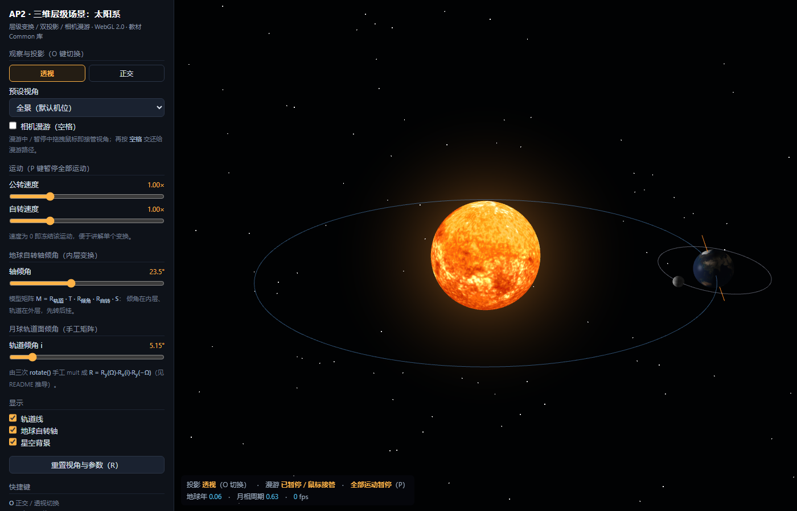
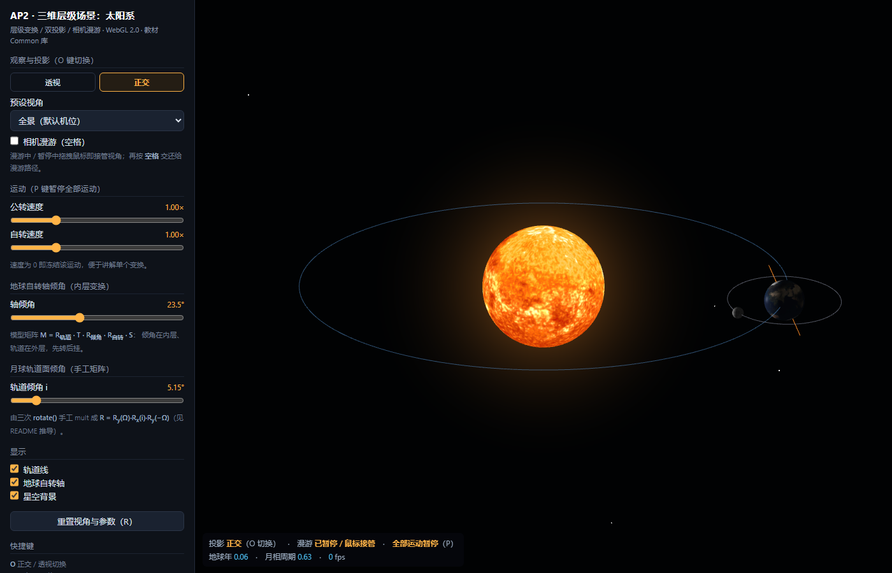
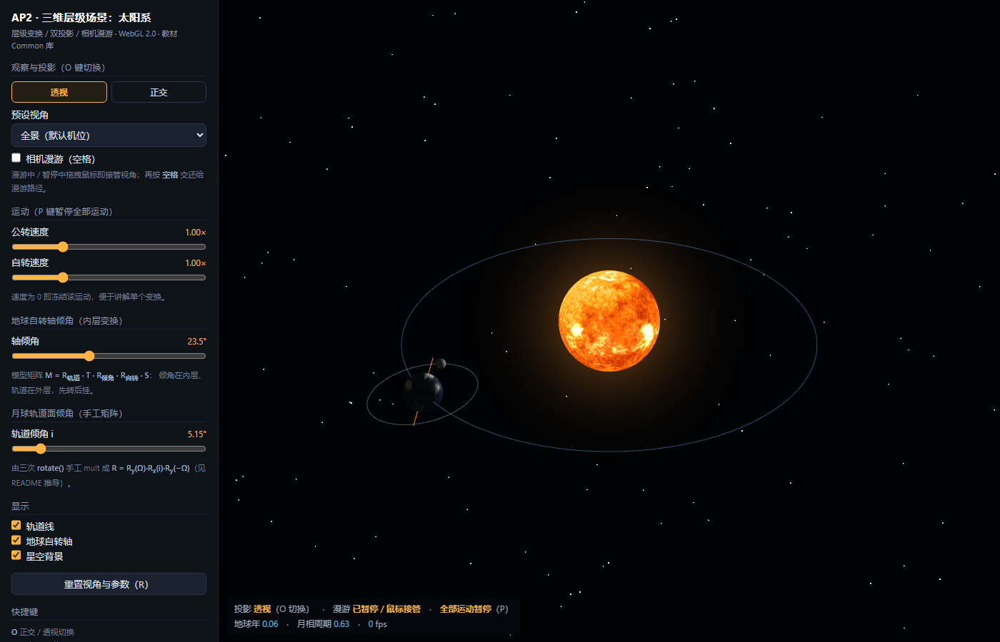
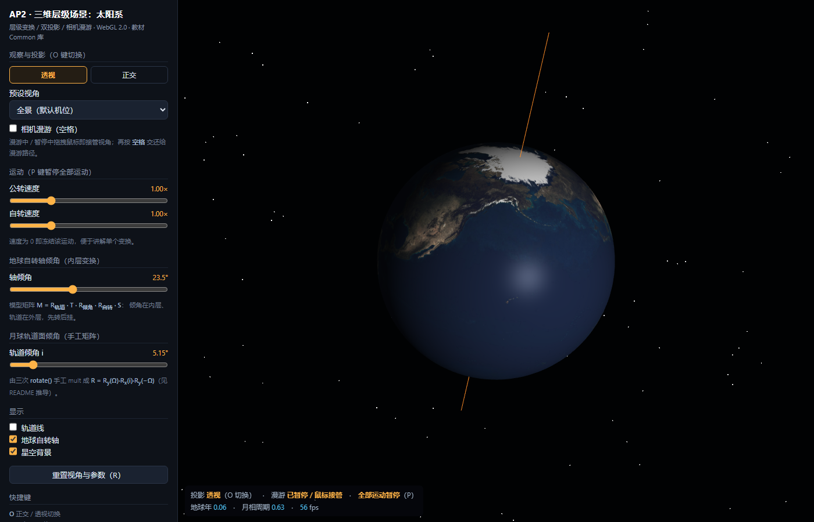

# AP2 · 三维层级场景：太阳系

原生 **WebGL 2.0**（GLSL ES 3.00）+ JavaScript 实现的三维太阳系场景：太阳–地球–月球三级层级变换、
位图纹理、透视 / 正交双投影、关键帧相机漫游。使用教材《Interactive Computer Graphics》
（Angel & Shreiner, 8E）配套的 `Common/` 库（`MV.js` / `flatten.js` / `initShaders.js`），
纯静态网页，无构建步骤。

技术重点：**模型矩阵沿树逐层相乘**（太阳→地球→月球）、**一处手工推导并 `mult` 出来的
倾斜轨道矩阵**（月球轨道面 5.15°）、**双投影对比**、**漫游与鼠标随时互相接管**。


---

## 操作

| 操作 | 效果 |
|---|---|
| `O` | 正交投影 ↔ 透视投影 切换（同一机位、同一时刻） |
| `空格` | 相机漫游 暂停 / 继续；继续时观察目标交还太阳系中心 |
| `P` | 暂停 / 继续全部运动（漫游不受影响） |
| `R` | 重置视角与所有参数 |
| `1` `2` `3` `4` | 预设视角：全景 / 黄道面侧视 / 黄道面俯视 / 地球特写 |
| 左键拖拽 | 绕观察目标旋转视角，并从漫游手里接管 |
| 滚轮 | 推拉，距离 1.6–140 |
| 面板 · 公转 / 自转速度 | 0–4×，0 即冻结该运动 |
| 面板 · 地球轴倾角 | 0–60°，默认 23.5° |
| 面板 · 月球轨道倾角 i | 0–40°，默认 5.15°，拖到 25° 以上最容易看清轨道面倾斜 |
| 面板 · 轨道线 / 自转轴 / 星空 | 显示开关 |

左下角状态栏显示投影类型、漫游状态、地球年（公转圈数）、月相周期、帧率。

---

## 层级结构

```
root
├── sun                 M = Ry(θ_sun) · S(3.0)                     ← 太阳自转
├── earthOrbit          M = Ry(θ_E)                                ← 外层：公转轨道变换
│   └── earthCenter     M = · T(12, 0, 0)                          ← 地球中心（平移 12）
│       ├── earth       M = · Rz(23.5°) · Ry(φ_E) · S(1.0)         ← 内层：先倾角、后自转
│       ├── earthAxis   M = · Rz(23.5°) · S(1.85)                  ← 地轴可视化（同一倾角）
│       └── moonOrbit   M = · [Ry(Ω)Rx(i)Ry(−Ω)] · Ry(θ_M)         ← 手工矩阵：轨道面倾角
│           └── moon    M = · T(2.8,0,0) · Ry(180°) · S(0.28)      ← 月球（潮汐锁定）
└── stars               M = I                                      ← 星空背景
```

每个节点只给出相对父节点的 `local(state)`，世界矩阵由 `Scene.collect()` 沿树逐层相乘：

```js
(function walk(node, parentM) {
  var m = mult(parentM, node.local(state));   // M_world = M_parent · M_local
  ...
  walk(child, m);                             // 以 m 作为子节点的"栈顶"递归下去
})(root, mat4());
```

递归传参等价于矩阵栈（函数返回即"弹栈"），不会出现手工 `push/pop` 时漏 `pop`
导致后面物体被错误累积变换的问题。

### 地球：倾角放在内层

```
M_earth = Ry(θ_E)  ·  T(12,0,0)  ·  Rz(23.5°)  ·  Ry(φ_E)  ·  S(1.0)
          └ 公转 ┘   └ 轨道半径 ┘   └── 地球自己的模型矩阵 ──┘
```

从右往左读（点的作用顺序）：缩放到地球半径 → 绕自己的 y 轴自转 → 把自己的自转轴扳歪 23.5°
→ 沿轨道半径平移到离太阳 12 的位置 → 连同歪掉的轴一起绕太阳公转。

倾角在地球自己的坐标系里生效，所以地轴相对地球固定了 23.5°，随后轨道变换把它整体带走。
反过来写成 `Rz(23.5°) · Ry(θ_E) · T · Ry(φ) · S`，23.5° 会作用到整条轨道上，
公转轨道面被掀翻。把面板里的"轴倾角"滑到 60° 可以直接看出两种写法的区别。

按这种嵌套写法，地轴方向 `Ry(θ_E)·Rz(23.5°)·(0,1,0)` 会随公转绕世界 y 轴画出一个
23.5° 的圆锥；若要让地轴在惯性系中固定，把 `Rz(23.5°)` 移到 `Ry(θ_E)` 左侧即可（一行改动）。

### 月球挂在地球中心节点

`earthCenter` 只做 `T(12,0,0)`，是地球质心；`earth` 才是带自转与倾角的孩子。
月球挂在 `earthCenter` 下，因此不会被地球自转拖着转，也不跟着地轴倾斜，
轨道面相对黄道面只有 5.15°，层级仍然是三级嵌套。

---

## 手动矩阵：月球轨道面倾角

场景里只有这一处不用复合函数，而是用 `mat4()` 单位阵 + 三次 `rotate()` 逐个 `mult`
出来（`js/transforms.js`）：

```js
X.moonOrbitPlane = function (nodeDeg, inclDeg) {
  var m = mat4();                                  // ① 单位阵起步
  m = mult(m, X.spinY(nodeDeg));                   // ② Ry(Ω)
  m = mult(m, X.rotX(inclDeg));                    // ③ ·Rx(i)
  m = mult(m, X.spinY(-nodeDeg));                  // ④ ·Ry(−Ω) —— 三步共轭
  return m;
};
```

**为什么不能直接 `rotate(i, [0,0,1])`**：月球轨道面要绕升交点轴倾斜，而升交点轴是黄道面内
一条方位角为 Ω 的直线，不是坐标轴。绕任意轴的旋转可以由三次基本旋转"夹"出来：

```
R_u(i) = Ry(Ω) · Rx(i) · Ry(−Ω)
```

依次作用是：`Ry(−Ω)` 把升交点轴转到与 x 轴重合 → `Rx(i)` 绕 x 轴倾斜 i 度（即绕升交点轴倾斜）
→ `Ry(Ω)` 转回原方位。

展开成 3×3（`c = cosΩ, s = sinΩ, ci = cos i, si = sin i`）：

```
        ┌ c² + s²·ci    s·si      c·s·(ci − 1) ┐
R(i,Ω) =│ −s·si         ci        −c·si         │
        └ c·s·(ci − 1)  c·si      s² + c²·ci    ┘
```

自洽性：`Ω = 0` 时退化为 `Rx(i)`；`R · u = u`（`u = (cosΩ, 0, −sinΩ)` 是不动轴，即升交点轴）；
该式就是 Rodrigues 公式 `Ⅰ·ci + si·[u]× + (1−ci)·uuᵀ` 的展开，`det R = 1`。

`Transforms.moonPlaneClosedForm()` 把上表逐元素写成解析解，启动时与三次 `rotate` 的结果比对，
控制台打印：

```
[矩阵自检] moonOrbitPlane = Ry(Ω)·Rx(i)·Ry(−Ω) 与解析解最大误差 = 1.11e-16  ✔
```

---

## 纹理

```
textures/earth.jpg ──Image──▶ gl.texImage2D(…, img)        ← 上传（此处处理 FLIP_Y）
                                   │
                          WebGLTexture（含 mipmap）
                                   ▼
geometry.js 每个顶点生成 (u,v) ──▶ aTexCoord ──▶ 顶点着色器 vUV
                                             ──▶ 片元着色器 texture(uTex, vUV) ──▶ 片元颜色
```

球体参数化（`Geom.sphere`，48×96）：`φ = π·i/48`（0 北极）、`θ = 2π·j/96`，
`u = j/96`，`v = 1 − i/48`（**北极 v=1**）。

**上下颠倒与修法**：位图在文件里自上而下存储（第 0 行是图像顶部），而 WebGL 纹理坐标系原点在
左下角、t 轴向上。原样上传时图像最上面一行对应 `t = 0`，球体上就成了"南极朝上、地图倒着贴"。

```js
gl.pixelStorei(gl.UNPACK_FLIP_Y_WEBGL, true);                 // 上传时翻转行序
gl.texImage2D(gl.TEXTURE_2D, 0, gl.RGBA, gl.RGBA, gl.UNSIGNED_BYTE, img);
gl.pixelStorei(gl.UNPACK_FLIP_Y_WEBGL, false);                // 复位（这是全局像素存储状态）
```

翻转后 `v=1` 对应图像顶部，与 `v = 1 − i/latBands` 配套。**等价的第二种修法**是不动 FLIP_Y、
把 UV 写成 `v = i/latBands`（北极 v=0），两种二选一，混用才会出错。

另外：`WRAP_S = REPEAT`（否则经度接缝有亮缝）、`WRAP_T = CLAMP_TO_EDGE`（否则极点采样到对面大陆）、
`generateMipmap` + `LINEAR_MIPMAP_LINEAR`（远景小天体不闪烁）、可选各向异性过滤。

---

## 双投影

| | 透视（默认） | 正交 |
|---|---|---|
| 矩阵 | `perspective(45°, aspect, 0.1, 600)` | `ortho(-h·a, h·a, -h, h, 0.1, 600)`，`h = dist·tan(45°/2)` |
| 远处物体 | 近大远小 | 大小与距离无关 |
| 平行线 | 收敛到消失点 | 永远保持平行 |
| 空间感 | 强 | 弱，像工程制图 |

`h` 取 `dist·tan(fov/2)`，使观察目标所在深度处的物体在两种投影下像素大小相同，
太阳大小一模一样，差异全部来自"远近"。

**透视** — 地球/月球在近端明显更大，轨道椭圆近端被撑开：



**正交** — 同一机位同一时刻：太阳不变，地球明显更小，轨道椭圆变成对称的标准椭圆：



---

## 相机漫游

- **路径**：`CONFIG.roam.keys` 里 7 个关键帧 `{t, az, el, dist}`，36 s 一圈首尾相接
  （末帧 `az` 写 390° 而非 30°，避免插值时绕远路反转 360°）。
- **插值**：均匀参数周期 **Catmull–Rom** 样条，只取相邻 4 个控制点、C¹ 连续、穿过所有关键帧，
  线性插值在关键帧处速度突变会"一顿一顿"。
- **平滑**：每帧 `k = 1 − exp(−rate·dt)` 指数趋近目标值，与帧率无关。
- **接管**：拖拽或滚轮立即 `roamPlaying = false`，视角交给用户；按 `空格` 交还，
  摄像机从当前朝向平滑飞回路径。状态栏与面板勾选框同步。
- **跟拍**：预设"地球特写"把观察目标切到地球质心（每帧取地球世界矩阵的平移列）。

漫游路径上的某一帧（t = 12 s）：



10 秒漫游录屏：[`screenshots/roam-10s.mp4`](screenshots/roam-10s.mp4)（1400×900 / 12 fps，
逐帧由真实 WebGL 渲染导出，画面中行星也在同步公转）。

---

## 代码结构

```
ap2-solar-system/
├── index.html          # 页面骨架 + 参数面板 + 3 组 GLSL ES 3.00 着色器（球体/纯色/光晕）
├── css/style.css
├── js/
│   ├── config.js       # 天体参数集中配置：半径/轨道半径/周期/倾角/纹理/漫游关键帧/颜色
│   ├── geometry.js     # 顶点生成：经纬球、单位圆、单位轴、星空（固定种子）
│   ├── textures.js     # 纹理上传（FLIP_Y / wrap / mipmap / 各向异性）
│   ├── transforms.js   # 手工矩阵 moonOrbitPlane() + 解析解 + 启动自检
│   ├── scene.js        # 场景图：节点 + local 矩阵 + 逐层 mult 遍历（不含 GL 调用）
│   ├── camera.js       # 球坐标机位、Catmull–Rom 漫游、拖拽接管、双投影
│   ├── interaction.js  # 输入：pointerdown/move/up、wheel、keydown
│   ├── ui.js           # 面板 ↔ 状态同步
│   └── main.js         # GL 初始化、VBO、状态、渲染循环、输入分发、URL 参数
├── Common/             # 教材 8E 配套库（MV.js / flatten.js / initShaders.js / utility.js）
├── textures/           # sun.jpg / earth.jpg / moon.jpg
└── screenshots/        # 截图与录屏
```

`scene.js` 不含 GL 调用，通过注入的渲染器画东西，层级逻辑可以脱离 WebGL 测试。

渲染顺序：星空（不写深度）→ 太阳光晕（加法混合）→ 不透明球体 → 透明线（轨道线 / 自转轴）。

三组着色器：`vbody/fbody` 采样纹理 + 以太阳为点光源的 Lambert 漫反射与 Blinn 高光
（`uEmissive` 让太阳跳过光照）；`vflat/fflat` 纯色线、点；`vglow/fglow` 面向摄像机的
公告板光晕。

---

## 实现要点

**行主序 vs 列主序**：`MV.js` 用 `m[row][col]` 存矩阵，`flatten(m)` 得到行主序；
`uniformMatrix4fv(transpose=false)` 按列主序解析，直接上传等于转置（平移跑到第 4 行、
透视投影崩掉）。`main.js` 的 `uploadMat4()` 按 `scratch[4i+j] = m[j][i]` 展开，
等价于 `flatten(transpose(m))` 且不额外分配。

**对 `Common/MV.js` 的修正**：教材的 `rotate(angle, axis)` 有 4 个非对角元素符号与
`rotateX/Y/Z` 相反，等价于绕轴旋转 −angle。已按标准右手旋转矩阵改正，
使 `rotate(30, [0,0,1]) ≡ rotateZ(30)`（文件内标注 `// ---- AP2 修正 ----`）。

**潮汐锁定不需要额外自转**：`moonOrbit` 的坐标系本身跟着公转角一起转，挂在其下的月球
天然"公转一圈自转一圈"；`CONFIG.bodies.moon.nearFace = 180` 只是把贴图正面转向地球。

---

## 截图与素材

| 文件 | 内容 |
|---|---|
| `s1-overview-persp.png` | 全景 · 透视 |
| `s2-overview-ortho.png` | 全景 · 正交（与 s1 同机位同时刻） |
| `s3-earth-tilt.png` | 地球特写：23.5° 倾角 + 自转轴 + 月球 |
| `s4-top.png` | 黄道面俯视：轨道共面、月球轨道环 |
| `s5-roam.png` | 漫游路径关键帧 |
| `s6-moon-plane.png` | 月球轨道倾角调到 25° 时的倾斜轨道面 |
| `roam-10s.mp4` | 10 秒漫游录屏 |

截图与录屏通过 URL 参数固定时间与机位复现（正常浏览不需要）：
`t`（固定模拟秒数并暂停）、`proj`、`view`、`cam=az,el,dist`、`incl`、`tilt`、
`no=lines,axis,stars`、`hud=0`、`ui=0`、`roamAt`、`shot=1`。
例如 `index.html?t=1.5&view=earth&no=lines&shot=1`。



| 资产 | 出处 |
|---|---|
| `Common/MV.js` 等 | 教材 8E 官方配套代码 |
| `textures/sun.jpg` | Solar System Scope，CC BY 4.0 |
